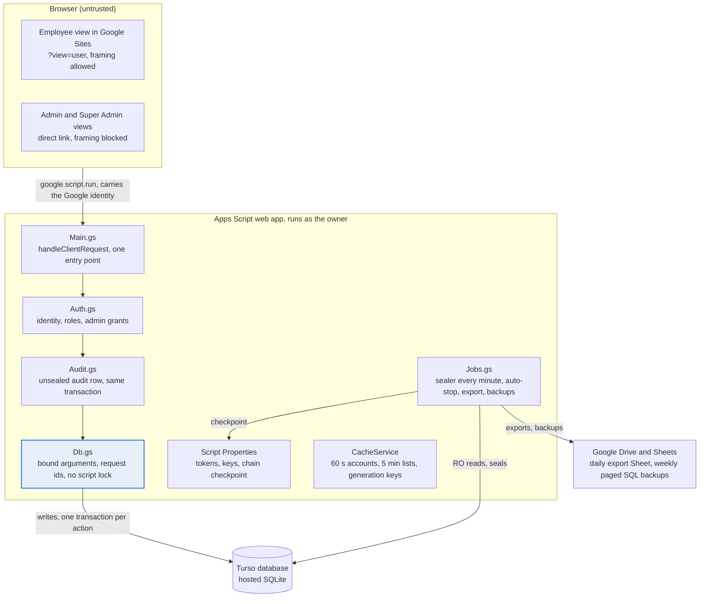
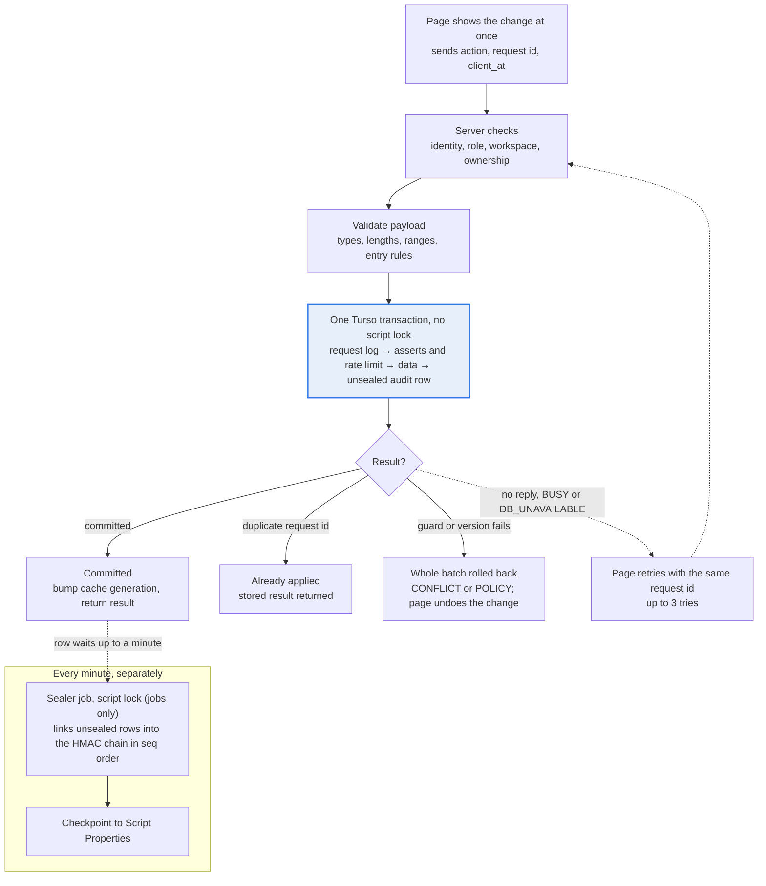
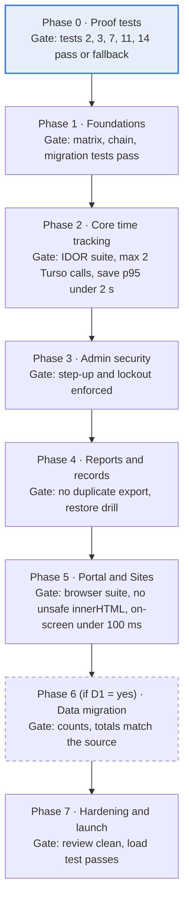

# FLINK Time — Turso Migration Plan

Nov 1, 2026 · @Bassam Sheta

## 1. Purpose, scope and decisions

FLINK Time moves its storage from Google Sheets to Turso, keeps Apps Script as the backend and Google Sites as the front end, and drops everything 25–75 users don't need. Nothing is built until the Phase 0 tests in section 14 pass; tests 2, 3, 7, 11 and 14 decide the architecture. This version was corrected after an independent review on 2026-11-01 and a speed and capacity review on 2026-11-03 (section 19).

**For the implementer:** build from *FLINK Time — Build Spec v1* (exact SQL, the Turso wire format, every action's payload and checks, file layout, test harness, ordered tickets). This plan explains why; the spec says exactly what, and wins where they differ.

**Decided (2026-11-01)**

| Area | Decision | Basis |
| --- | --- | --- |
| Front end | Employee view embedded in Google Sites; admin views opened directly, never framed | Your choice; repo README |
| Backend | Apps Script web app, runs as the deployer, Workspace-domain access only | Your choice; current manifest |
| Database | Turso (hosted SQLite), free plan | Your choice |
| Employee sign-in | Google Workspace identity + server-side allowlist; no app passwords | Your answer |
| Authenticator codes | Admin and Super Admin at sign-in, plus step-up for sensitive actions | Your answer |
| Features in v1 | Timer and personal entries; reports and exports; multiple workspaces; clients, projects, tasks | Your answer |
| Users | 25–75 | Your answer |
| Records | Full audit trail plus a daily export to a private Google Sheet | Your requirement |

**Kept from the current code** (rules the first draft had forgotten)

- Runaway-timer protection: `AUTO_STOP_HOURS` (default 14) and the 24-hour cap per entry (`MAX_SINGLE_ENTRY_HOURS`), plus the scheduled auto-stop job.
- Project access checks before a timer starts or switches project.
- Root Super Admin protection and "no actions on your own account".
- Deactivation closes the person's running timer and memberships in one step.
- Entry rules: edit window (`PAST_ENTRY_EDIT_DAYS`, default 7), required description/project/task flags, user-delete and project-switch toggles, catalog-validated settings.
- Hiding hourly and cost rates from regular users.

**Removed from the current codebase**

- Timesheets and approvals (not selected for v1).
- App passwords, password hashing (\~700 ms per login), email password recovery.
- Cloud KMS for authenticator secrets.
- One spreadsheet per workspace, yearly data files, spreadsheet-copy backup and restore.
- The five rollup tables; SQL queries replace them.
- Lock-and-flush choreography and intent/completion audit pairs; explicit database transactions replace them.

**Decided (2026-11-03)** (formerly the open decisions; section 17)

| ID | Decision |
| --- | --- |
| D1 | No existing data to migrate. Phase 6 is dropped; the database starts empty |
| D2 | v1 ships **tags** and **live view**. Manual entries, WFH tracking, admin requests, saved reports/dashboards, scheduled reports, alerts and comments wait for v2. Entries are created only by the timer |
| D3 | One database with a `workspace_id` column |
| D4 | Turso tokens with a 120-day expiry, rotated every 90 days without `invalidate` |
| D5 | Entries count on their start date in the workspace timezone |
| D6 | A Super Admin sets each Admin's own limit on active workspaces they administer; unset means the global default (3) |
| D7 | Turso free plan permanently, so backups, restore drills and usage warnings are mandatory |
| — | Project access is per project (`projects.restricted`), replacing today's rule where one access row restricts every project in the workspace |
| — | The v1 portal is written fresh (reusing the old CSS and QR library), not edited from the current 6,579-line page |

## 2. Target architecture

Google Sites shows the pages, Apps Script does all the work, Turso stores the data and Google Drive keeps the outside copies; only the Apps Script backend ever holds a database token.

*Only Apps Script talks to Turso; the browser never holds a database token.*

Every browser action passes through one entry point, is authorised, gets its audit row built and reaches Turso as one explicit transaction using the write token. User requests never take an Apps Script lock; the database serialises writes itself. A one-minute sealer job links new audit rows into the hash chain (section 6). Scheduled jobs read with the read-only token and write only their own bookkeeping (export state, job runs, alerts, seals) with the write token, under the script lock, which only jobs use.

## 3. Identity, access control and admin codes

Every request is identified by the caller's Google Workspace account and re-authorised on the server; the browser is never trusted. Admins also prove an authenticator code, held as a grant that lives only in the page.

**Checks on every request, in this order**

1. Read `Session.getActiveUser().getEmail()`. Blank → reject with `AUTH_UNAVAILABLE`. Google documents a blank result for "execute as me" web apps, but says the restriction generally doesn't apply to users in the developer's own Workspace domain ([Class User](https://developers.google.com/apps-script/reference/base/user?authuser=0)).
2. Lowercase and trim the email. The part after the last `@` must equal the configured company domain exactly; a suffix check would accept look-alike domains.
3. Load the account by email (cached 60 s). Missing → `NOT_PROVISIONED`; no self-signup. Status not `ACTIVE` → `ACCOUNT_INACTIVE`.
4. Look the action up in the permission map. Unknown action → reject.
5. Check the role, then workspace membership, then record ownership (employees only touch their own entries and timer).
6. Admin actions: valid admin grant. Sensitive actions: a code entered in the last 5 minutes (step-up).
7. Validate the payload against the action's schema and the settings rules (section 5) before any database call.

**Roles**

| Role | Can do | Authenticator code |
| --- | --- | --- |
| User | Own timer, own entries, own reports without rates or costs; read projects and tasks they may track | Never |
| Admin | Everything a user can, plus clients, projects, tasks, members and reports in workspaces where they are a workspace admin | At sign-in; step-up for sensitive actions |
| Super Admin | Everything, plus users, workspaces, settings, audit and security | At sign-in; step-up for sensitive actions |

Workspace admin rights = account role Admin or Super Admin **and** `ws_role = ADMIN` in that workspace. Only a Super Admin, with step-up, can set `ws_role = ADMIN`, so a workspace admin can't promote anyone.

**Server rules that can't be bypassed** (each has a test, section 13)

- Nobody changes their own role or status, or deletes themselves.
- The root Super Admin can't be demoted, deactivated, re-emailed or have their authenticator reset through the app. The Super Admin role is granted only by an owner-run editor function. This mirrors the current code (`Code.gs` around line 13886).
- At least one active Super Admin always remains.
- A timer can start or switch only on an active project in an active workspace that the user may track: the project is unrestricted, or the user is an Admin or Super Admin, or the user has a `project_access` row with `can_track = 1`.
- Archived workspaces are read-only.

**Admin grant**

- After Google sign-in, the admin enters a 6-digit code (RFC 6238, 30-second steps, one step of clock drift allowed). A code whose step was already used is rejected.
- Success creates a grant token: the hex of three `Utilities.getUuid()` values (about 366 random bits). Apps Script has no secure random-bytes API, and `Math.random` is never used.
- The token is kept only in page memory (no cookies, no localStorage). The database stores its SHA-256 hash, the user, expiry, step-up time and the account epoch. `last_seen_at` is written at most once every 5 minutes to save writes.
- Each admin request sends the token; the server checks the hash, the same Google identity, expiry, revocation and the account epoch.
- Idle expiry 30 minutes, absolute 8 hours (proposals; Super Admin settings).
- Why the token lives in the page: a grant tied only to the email would pass to anyone holding a stolen Google session.

**Step-up actions** (fresh code within 5 minutes): create, change the role of, deactivate, reactivate or unlock a user; issue an enrollment code; create or archive a workspace; set workspace admins; change settings; any CSV export; edit or delete another person's entries; any key or token rotation. On-screen reports need only the admin grant.

**Enrollment** (fixed after review: the first draft let a stolen Google session enroll its own authenticator)

- Enrollment needs a single-use 10-character enrollment code. A Super Admin issues it with step-up when creating or resetting an admin. It is shown once, handed over in person, valid for 24 hours and stored only as a hash.
- The root Super Admin's first enrollment runs from an owner-only editor function.
- Enrollment shows a QR code drawn locally by the repo's pinned `nayuki-qr.js`, plus the manual key, and requires a confirming code. It issues 8 one-time backup codes, stored only as hashes.

**Guessing protection**

- 5 wrong codes lock code entry for 15 minutes (the current values) and email the owner.
- 3 lockouts within 24 hours lock code entry until a Super Admin unlocks it (step-up, audited). Without this, a stolen Google session could keep guessing at about 480 tries a day.
- Lost phone: a backup code gives a 10-minute enrollment-only grant, or a Super Admin resets the admin and issues a new enrollment code.

**Employees and offboarding**

- Employees have no app session: each call carries their Google identity. Signing out of Google ends access.
- `users.deactivate` is one transaction: the running timer is closed into an entry, memberships are set inactive, the account becomes `INACTIVE`, the account epoch is bumped and grants are revoked. The current code does the same (`Code.gs` around line 14068). The cache makes it effective within 60 seconds.
- `users.revokeGrants` signs an admin out everywhere without deactivating them.
- Also suspend the person's Workspace account.
- Browsers signed into several Google accounts are reported by the community to confuse Apps Script identity; Phase 0 test 7b checks it, and the documented workaround is a separate browser profile.

## 4. Database schema

One Turso database holds every workspace; each workspace table carries `workspace_id`, and every query function requires it (decision D3). The database enforces what it can: one timer per user, unique emails, valid states and entries between 0 and 24 hours long.

**Conventions**

- IDs: text UUIDs from `Utilities.getUuid()`.
- Times: integer Unix milliseconds, UTC. Entries also store `local_date` (YYYY-MM-DD in the workspace timezone). It is recomputed whenever `start_at` changes, and a workspace timezone change runs a job that rewrites it.
- Money: integer minor units (piastres/cents), never floating point.
- Every mutable row has `version` for optimistic concurrency.
- Guards don't rely on `changes()`: each conditional write is preceded by an assert insert that fails when the expected row or version is missing (section 6), using a one-column `_assert` table whose column is `NOT NULL`.
- Entries are soft-deleted (`deleted_at`); only scheduled purge jobs hard-delete housekeeping tables.
- Which engine Turso's hosted service runs isn't confirmed by Turso (a third-party 2026 article says libSQL), so Phase 0 test 5 applies this whole schema on the hosted free database before any code is written.

**Tables**

| Table | Key columns (beyond id, timestamps, version) | Constraints and indexes |
| --- | --- | --- |
| `schema_migrations` | version, name, applied\_at, checksum | PK version |
| `accounts` | email, display\_name, role, status, employee\_code, is\_root, auth\_epoch, admin\_ws\_limit (D6) | UNIQUE email; role in USER/ADMIN/SUPER\_ADMIN; status in ACTIVE/INACTIVE; at most one root |
| `workspaces` | code, name, status, timezone, week\_start | UNIQUE code; status in ACTIVE/ARCHIVED; week\_start in SUN/MON/SAT |
| `workspace_members` | workspace\_id, user\_id, ws\_role, active, department, team, job\_title | PK (workspace\_id, user\_id); ws\_role in MEMBER/ADMIN |
| `clients` | workspace\_id, name, status, notes | UNIQUE (workspace\_id, name) |
| `projects` | workspace\_id, client\_id, name, code, status, restricted, billable\_default, hourly\_rate\_minor, cost\_rate\_minor, estimate\_minutes, budget\_minor, start\_date, end\_date, color | UNIQUE (workspace\_id, name); index (workspace\_id, status) |
| `tasks` | workspace\_id, project\_id, name, status, estimate\_minutes, billable\_default, sort\_order | index (project\_id) |
| `project_access` | workspace\_id, project\_id, user\_id, can\_track | PK (project\_id, user\_id); index (user\_id) |
| `tags`, `entry_tags` | workspace\_id, name, color, status / entry\_id, tag\_id | UNIQUE (workspace\_id, name); PK (entry\_id, tag\_id) (D2: kept) |
| `active_timers` | user\_id, workspace\_id, timer\_id, project\_id, task\_id, description, started\_at, local\_date, billable, tag\_ids\_json | PK user\_id: one running timer per person |
| `time_entries` | workspace\_id, user\_id, project\_id, task\_id, description, start\_at, end\_at, duration\_s, local\_date, billable, rate snapshots, source, stop\_reason, timer\_id, deleted\_at, deleted\_by | CHECK end\_at ≥ start\_at; CHECK end\_at − start\_at ≤ 86,400,000; CHECK duration\_s = (end\_at − start\_at) / 1000; source in TIMER/MANUAL/IMPORT (v1 writes only TIMER); UNIQUE timer\_id; stop\_reason in USER/AUTO\_STOP/DEACTIVATION; indexes (workspace\_id, user\_id, start\_at), (workspace\_id, project\_id, start\_at), (workspace\_id, local\_date), (workspace\_id, user\_id, local\_date) |
| `settings` | scope (GLOBAL or workspace\_id), key, value | PK (scope, key); values validated against the settings catalog |
| `admin_mfa` | user\_id, secret\_enc, key\_version, enabled, last\_step, failed\_count, locked\_until, lockouts\_24h, hard\_locked, backup\_hashes, enroll\_code\_hash, enroll\_code\_expires\_at | PK user\_id |
| `admin_grants` | token\_hash, user\_id, kind, last\_seen\_at, expires\_at, stepup\_at, revoked\_at, auth\_epoch | PK token\_hash; kind in ADMIN/ENROLL/RECOVERY; index (user\_id) |
| `request_log` | user\_id, request\_id, action, payload\_sha256, result\_json, created\_at | PK (user\_id, request\_id): makes retries safe (section 6); index (user\_id, created\_at) for the rate limit (section 7) |
| `_assert` | must\_exist | must\_exist NOT NULL; never holds rows |
| `audit_log` | seq, ts, actor\_user\_id, actor\_role, workspace\_id, entity\_type, entity\_id, action, before\_json, after\_json, reason, request\_id, prev\_hash, record\_hash, key\_version, sealed\_at | `seq INTEGER PRIMARY KEY AUTOINCREMENT` (one global chain, assigned by the database); `prev_hash`, `record_hash`, `key_version`, `sealed_at` are NULL until sealed; index (workspace\_id, seq); partial index on seq WHERE sealed\_at IS NULL |
| `chain_head` | id (always 1), seq, hash | PK id; written only by the sealer |
| `security_events` | ts, email, user\_id, event\_type, success, detail\_json | index (ts), index (email, ts) |
| `export_state` | name, last\_seq, last\_run\_at, status | PK name |
| `job_runs` | job, started\_at, ended\_at, status, cursor, items, error | index (job, started\_at) |

**Size estimate (assumptions, not measurements):** 75 users × 10 entries a day × 260 working days ≈ 195,000 entries a year. With audit rows carrying before/after JSON, roughly 0.4–0.8 GB a year, inside the free plan's 5 GB ([pricing](https://turso.tech/pricing.md)) for several years. That is 33–67 MB a month, so the database outgrows a single 50 MB download within one or two months; backups are paged from the start (section 9).

## 5. Backend structure and action catalogue

The backend keeps one public entry point, `handleClientRequest(action, data)`, and one permission map, but splits the 19,031-line `Code.gs` into small files with one job each. Apps Script shares one global scope across a project's `.gs` files, so the split costs nothing at runtime; the installer and the staging upload list must be updated for the new file list.

**Files**

| File | Job |
| --- | --- |
| `Main.gs` | `doGet`, `handleClientRequest`, error contract, request ids |
| `Db.gs` | Turso client: explicit transactions (section 6), bound arguments only, read-only vs write token. User requests take no script lock, so a slow Turso call delays only its own request; writes are retried only with the same request id |
| `Auth.gs` | Identity, account cache, permission map, server rules (section 3), admin grants, step-up, rate limits |
| `Totp.gs` | Code checks, enrollment codes, backup codes, secret encryption, lockouts |
| `Audit.gs` | Canonical JSON, HMAC chain, chain head, verification |
| `Validate.gs` | Per-action payload schemas, the settings catalog (type, min, max, options, step-up), entry policy rules, formula-injection neutralising |
| `Actions*.gs` | Workspaces, members, catalogue (clients/projects/tasks), timer, entries, reports, users |
| `Jobs.gs` | Audit sealer (every minute), auto-stop, daily export, chain checks, paged backup, purges, health |
| `Migrations.gs` | Numbered SQL migrations and the owner-only runner |
| `Setup.gs` | Owner-only first-run page that stores tokens in Script Properties (section 12) |
| `Portal.html` | The single page template for all three views |

**Response contract:** `{ok: true, data}` or `{ok: false, code, message, retryable}`. Codes: `AUTH_UNAVAILABLE`, `NOT_PROVISIONED`, `ACCOUNT_INACTIVE`, `FORBIDDEN`, `CODE_REQUIRED`, `STEP_UP_REQUIRED`, `LOCKED_OUT`, `VALIDATION`, `POLICY` (an entry rule blocked it), `NOT_FOUND`, `CONFLICT` (version mismatch), `BUSY` (database busy, retryable), `RATE_LIMITED`, `DB_UNAVAILABLE` (retryable), `INTERNAL`.

**Entry rules kept from the current code**

- Users may edit, update or delete only entries within `PAST_ENTRY_EDIT_DAYS` (default 7, `Code.gs` line 5948).
- `REQUIRE_DESCRIPTION`, `RULE_PROJECT_REQUIRED`, `RULE_TASK_REQUIRED`, `ALLOW_USER_DELETE_ENTRY` and `ALLOW_USER_PROJECT_SWITCH` keep their meaning.
- Stop clamps a timer at the lower of `AUTO_STOP_HOURS` (default 14) and 24 hours (`MAX_SINGLE_ENTRY_HOURS`, `Code.gs` line 224).
- An hourly job closes runaway timers with `stop_reason = AUTO_STOP` and an audit row by actor `SYSTEM`.
- Timer start, stop and switch carry the browser's timestamp `client_at` (added 2026-11-03). The server uses it when it is within 2 minutes of server time, not before the timer's start and not in the future; otherwise it uses server time. Without this, a stop retried after `BUSY` or `DB_UNAVAILABLE` would be saved late by the length of the retry. Both times are kept in the audit row.

**Paging** (added 2026-11-03): `entries.list`, `reports.detailed`, `audit.list`, `security.events` and `users.list` return at most 200 rows per call with a cursor on (`start_at` or `seq`, `id`); no offset paging. This keeps every response under the `google.script.run` and 100 KB cache limits as data grows.

**Actions in v1**

| Group | Actions | Roles | Step-up | Turso calls |
| --- | --- | --- | --- | --- |
| Session | `app.bootstrap` (who am I, workspaces, running timer, projects/tasks in one go) | All | No | 0–1 |
| Admin codes | `auth.status`, `auth.verifyCode`, `auth.stepUp`, `auth.logout`, `auth.enrollStart`, `auth.enrollConfirm` (with enrollment code or backup-code grant), `auth.useBackupCode` | Admin, Super Admin | — | 1–2 |
| Timer | `timer.start`, `timer.stop`, `timer.switch` | All (own) | No | 1–2 |
| Entries | `entries.list`, `entries.update`, `entries.delete`, `entries.bulk` (no manual creation in v1, D2) | All (own); workspace admin | Only for others' entries | 1–2 |
| Catalogue | `clients.*`, `projects.*`, `tasks.*`, `tags.*`, `projectAccess.set` (list for all; create/update/archive for workspace admins) | All / workspace admin | No | 1–2 |
| Live view | `live.list` (who is tracking now; shared 60 s cache) | Workspace admin, Super Admin | No | 0–1 |
| Workspaces | `workspaces.list`, `.create`, `.update`, `.archive`; `members.list`, `.add`, `.update`, `.remove`, `.setAdmin` | Super Admin; workspace admin for members (not `ws_role`) | Yes for workspace writes and admin rights | 1–2 |
| Users | `users.list`, `.create`, `.update`, `.setAdminLimit` (D6), `.deactivate`, `.activate`, `.unlock`, `.revokeGrants`, `.issueEnrollCode` | Super Admin | Yes for writes | 1–2 |
| Reports | `reports.summary`, `reports.detailed` | All (own, no rates or costs); workspace admin; Super Admin | No | 0–1 (cached) |
| Exports | `reports.exportCsv` | Workspace admin, Super Admin | Yes | 1–2 |
| Settings | `settings.get`, `settings.patch` | Super Admin | Yes for patch | 1–2 |
| Audit and health | `audit.list`, `audit.verify`, `security.events`, `system.health` | Super Admin | Yes for verify | 1+ |

Workspaces are archived, never deleted. The Build Spec (section 6) gives every action's payload, checks and audit rows.

**Privacy in responses:** user-role responses (entries, summary, detailed, CSV) are built from an allowlist that leaves out hourly rate, cost rate and money totals, as the current tests require. An admin filter naming a user who isn't in that workspace is refused.

The full permission matrix is generated from the permission map and tested action by action (section 13).

## 6. Write path, retries and audit chain

Every change commits together with its audit row in one explicit database transaction and carries a request id so a retried request can never apply twice. No Apps Script lock is held: the database orders writes, and a sealer job links audit rows into the hash chain within a minute (corrected 2026-11-03: the first design held one global script lock across each Turso call so the chain hash could be computed in the request). This replaces the current intent/completion audit pairs and recovery helpers, which exist because Sheets has no transactions.

*A retry can never write twice: one batch, one request id; the chain is sealed within a minute.*

A timed-out call is retried with the same request id, so it either finds its own committed result or writes once; any failed guard rolls the whole transaction back.

**Correction after review:** the first draft said Turso runs a pipeline as one transaction. It doesn't: each `execute` commits on its own, and an error inside a manual transaction aborts only that statement, so a later `COMMIT` would save a half-done write. Turso's HTTP API v2 has a `batch` request whose steps run only if a named earlier step succeeded ([HTTP v2 spec](https://upd.dev/tursodatabase/libsql/src/branch/origin/docs/HTTP_V2_SPEC.md)); the official libSQL clients build transactions this way.

**Transaction form (one HTTP request)**

1. Step 0: `BEGIN IMMEDIATE`.
2. Step 1, only if step 0 succeeded: insert into `request_log` (user, request id, action, payload hash, result).
3. Next, each only if the previous step succeeded: assert inserts that fail when an expected row or version is missing, and the rate-limit assert (section 7).
4. Then the data changes and the unsealed audit row (no hash yet; the database assigns `seq`), each only if the previous step succeeded.
5. `COMMIT` only if the last step succeeded, then a `ROLLBACK` step that runs only if `COMMIT` did not succeed.

The server reads which step failed by its index, never by parsing error text. Plan B, if Phase 0 shows step conditions don't work over HTTP: an interactive transaction using the baton, one extra round trip; the reviewer verified Turso gives interactive transactions a 5-second window.

**Retries and duplicates**

- The page creates a UUID per user action and reuses it on every retry.
- The `request_log` insert is the first step, so a retry of something already committed fails there, before any version or timer check.
- The server then reads the stored row. If user, action and payload hash match, it returns the stored result; otherwise `VALIDATION`. Only retries pay this extra read.

**Locking** (redesigned 2026-11-03)

- User requests take no Apps Script lock. `BEGIN IMMEDIATE` makes Turso run write transactions one at a time, for milliseconds, inside the database; Apps Script's script-wide lock would instead have queued every writer for a whole HTTP call (150–800 ms each, so 20 writers at 09:00 would wait up to 15 s).
- `UrlFetchApp.fetch` has no timeout setting (community reports put Google's own limit near 60 seconds). Without a shared lock, a hung Turso call delays only its own request; the page retries with backoff and the same request id. Phase 0 measures worst-case call times.
- If Turso reports the database busy, the server returns `BUSY` (retryable) and the page retries with the same request id.
- The script lock is used only by jobs (sealer, exports, backups) with `tryLock`, so jobs never overlap and never block users.

**Audit sealer** (new 2026-11-03)

- A time trigger every minute, under the script lock, reads unsealed audit rows in `seq` order (one read), computes each row's `prev_hash` and `record_hash`, and writes them plus `chain_head` in one conditional transaction that asserts the chain head it started from (one write). It stops at 500 rows per run and continues next minute.
- Idempotent and resumable: a rerun after a crash finds the same unsealed rows and the same chain head.
- After each successful seal it writes the new sequence and hash to Script Properties (`CHAIN_CHECKPOINT`).
- Cost: one Turso read per minute when idle, roughly 15–30 minutes of the 6-hour daily trigger budget; the health job tracks it.
- Trade-off: a row is unsealed for up to about a minute. Someone holding the database token could change or delete a row in that window without breaking the chain. Rows already sealed are covered exactly as before. A gap in `seq` (a deleted unsealed row) is itself flagged, because `AUTOINCREMENT` never reuses numbers.
- Fallback if Phase 0 test 11 shows Turso can't sustain the write rate: the previous design (script lock around each write, hash computed in the request).

**Audit chain**

- One global chain (corrected: per-workspace chains bought nothing, because the database already gives every write one global `seq` and one sealer links them). Each row records its workspace.
- `record_hash = HMAC-SHA256(key[key_version], canonical JSON of seq, time, actor, action, entity, before, after, reason, request id, prev_hash)`, computed over string-normalised values because the HTTP API may return numbers as strings (Phase 0 test 4). The repo's `storage-v2/LogChain.gs` has a canonical-JSON routine to reuse.
- The HMAC key lives in Script Properties, never in Turso. Someone with only the database token can change rows but can't produce valid hashes: tampering is detected, not prevented.
- After each seal the sealer writes the new sequence and hash to Script Properties, so deleting the newest sealed rows is detected within a minute, not a day later. The checkpoint can lag the database (rows beyond it are expected) but never run ahead of it; a checkpoint beyond the database head, or a hash mismatch, is an alarm.
- Audited reads (exports, audit views) write their audit row in a small transaction like any other write.
- Before/after JSON never contains secrets.
- Checks run nightly from the last checkpoint, plus a full re-verification weekly. A mismatch emails the owner, logs a security event and shows a banner to Super Admins.

## 7. Call budget, caching, quotas and speed

At 25–75 users the limit that matters is Apps Script's 30 simultaneous executions per user, because every request runs as the deployer; daily call counts stay under 10% of quota on the estimates below. Capacity is not the problem; speed is, and it is handled by the speed targets at the end of this section.

**Limits** (official pages)

| Limit | Value | Source |
| --- | --- | --- |
| URL Fetch calls (Workspace account) | 100,000 / day | [Apps Script quotas](https://developers.google.com/apps-script/guides/services/quotas?hl=en) |
| Simultaneous executions | 30 per user, 1,000 per script | [Apps Script quotas](https://developers.google.com/apps-script/guides/services/quotas?hl=en) |
| Single execution / trigger runtime (Workspace) | 6 minutes / 6 hours a day | [Apps Script quotas](https://developers.google.com/apps-script/guides/services/quotas?hl=en) |
| URL Fetch response size | 50 MB / call | [Apps Script quotas](https://developers.google.com/apps-script/guides/services/quotas?hl=en) |
| CacheService | 100 KB per value, 6-hour maximum lifetime, 1,000 items, early eviction possible | [Class Cache](https://developers.google.com/apps-script/reference/cache/cache) |
| Turso free: storage / rows read / rows written | 5 GB / 500 M a month / 10 M a month | [Turso pricing](https://turso.tech/pricing.md) |

Google states its quotas can change without notice, so the health job measures usage itself (below).

**Estimated use at 75 users** (assumptions, to be replaced by Phase 0 and staging measurements)

| Measure | Assumption | Estimate | Share of limit |
| --- | --- | --- | --- |
| Requests | 40 actions per user per day | 3,000 / day | — |
| Turso calls | ≤ 2 per request | ≤ 6,000 / day | ≤ 6% of URL Fetch |
| Rows written | \~1,000 writes a day × 4–5 rows (request log, data, audit row, its later seal update, plus the sealer's chain head) | \~150,000 / month | \~1.5% |
| Rows read | 2,000 report runs a month × 15,000 indexed rows | \~30 M / month | \~6% |
| Peak concurrency | 75 timer starts within 5 minutes at 09:00 | well under 30 at once | Bursts covered by retry |

**Caching rules** (the cache only speeds things up; a miss always falls back to the database)

- Account and memberships: 60 seconds (so a deactivation takes effect within 60 seconds).
- Admin grants: 60 seconds; revocation also clears the entry.
- Projects, tasks and clients per workspace: 5 minutes, invalidated on any change in that workspace.
- Report results: 5 minutes, only when under 90 KB; a user's own writes invalidate their report entries. Admin reports can therefore be up to 5 minutes behind other people's writes; the report screen shows "as of" time and a refresh button that bypasses the cache.
- Invalidation uses generation numbers, not key deletion: CacheService can't delete by prefix, so each workspace (and each user's report scope) has a small `gen` value, every cache key includes it, and "clear" means incrementing it. Old entries simply expire.

**Call-saving rules**

- One Turso request per action; never one request per row.
- Page load is one `app.bootstrap` action that returns everything the first screen needs.
- The running timer ticks in the browser; the page never polls the server for it.
- Live view (kept, D2) is computed at most once a minute per workspace and shared by all viewers; the page refreshes it every 60 s only while visible.
- Per-user rate limit: 60 write actions a minute, enforced inside the write transaction as an assert step that counts the user's `request_log` rows from the last minute (cache counters aren't atomic, and there is no global write lock to count under; section 6).
- List actions are paged (section 5), so no single response grows with the data.

**Usage tracking without extra tokens:** the health job adds up the `rows_read` and `rows_written` values Turso returns with every response, counts its own URL Fetch calls, and measures database size with `SELECT page_count * page_size FROM pragma_page_count(), pragma_page_size()` (Phase 0 test 13 checks this works). It warns at 70% of any limit.

**Speed targets** (added 2026-11-03)

Apps Script and Google Sites add a fixed cost to every server call that can't be engineered away, so the app matches top-tier time trackers on how fast it *feels*, not on raw server time. The estimates below are to be replaced by Phase 0 test 14.

| Step of one save | Estimated cost |
| --- | --- |
| `google.script.run` round trip (Sites iframe → Google → script) | \~0.4–1 s; more after the script has been idle |
| Loading and running the script project | 50–300 ms; grows with total code size |
| One Turso HTTPS call (transaction) | 150–800 ms (test 1 target: p95 under 800 ms) |
| Checkpoint write to Script Properties | \~50–100 ms |
| **Total server confirmation** | **about 1–2.5 s** |

| Target | Value | Measured by |
| --- | --- | --- |
| Screen reacts to timer start / stop / switch, entry edit | under 100 ms (no server wait) | Browser suite timings |
| Server confirmation of a write, p95 | under 2 s | Phase 0 test 14; staging |
| Employee page usable inside Sites, p95 | under 3 s | Phase 0 test 14; staging |
| Reports and lists, p95 | under 3 s | Staging |

**How the page meets them**

- **Optimistic updates** for timer start, stop and switch and for the user's own entry edits: the page updates at once, shows a small "saving" state, and the server confirms in the background. A refusal (`POLICY`, `CONFLICT`, `FORBIDDEN`) rolls the screen back and says why. Admin and step-up actions are never optimistic.
- **Skeleton first paint:** `doGet` makes no database call; the page draws its layout immediately and fills it from the single `app.bootstrap` call.
- **Small script project:** Apps Script loads the whole project on every call, so the removed features (section 1) are deleted outright, not left dormant, and no file does work at load time (no top-level reads, no large constant tables built eagerly). Target: under 300 KB of server code, measured in CI.
- **Small page:** `Portal.html` (281 KB today) loses the removed screens; the user view carries only user-view markup and code, as it already does via the template.
- **Turso region chosen for Apps Script, not for Egypt:** the delay that matters is Apps Script ↔ Turso, and Apps Script mostly runs in Google's US data centres; test 1 compares a US-East region with an EU region.
- If test 14 shows server confirmation p95 above 2.5 s, the Worker fallback (section 16) moves from last resort to the main option for the hot actions.

## 8. Secrets, tokens and key rotation

All secrets live in Script Properties of the production Apps Script project, which only the owner may edit; anyone with edit access to that project can read every secret, so editor access equals full compromise.

**Secrets**

| Secret | Used for | Rotation |
| --- | --- | --- |
| `TURSO_URL` | Database address | On database move |
| `TURSO_RW_TOKEN` | All writes, including jobs' bookkeeping | Every 90 days; at once on suspicion |
| `TURSO_RO_TOKEN` | Report reads, export reads, chain checks | With the write token |
| `AUDIT_HMAC_KEY_v{n}` | Audit chain hashes | Yearly; old versions kept for verification |
| `TOTP_ENC_KEY_v{n}` | Encrypting admin authenticator secrets | Yearly, re-encrypting all secrets |
| `CHAIN_CHECKPOINT` | Latest sealed audit sequence and hash (section 6) | Written after every seal |
| `CODE_PEPPER` | Hashing enrollment and backup codes (they are short, so a plain hash could be brute-forced from a database copy) | With the TOTP key |
| `OWNER_EMAIL`, `COMPANY_DOMAIN` | Owner checks; the exact domain match in section 3 | Set once at setup |
| `EXPORT_FOLDER_ID`, `BACKUP_FOLDER_ID`, `ALERT_EMAIL` | Jobs | As needed |

**Turso tokens** (decision D4; corrected after review)

- Turso can issue read-only tokens and tokens with an expiry ([CLI docs](https://docs.turso.tech/cli/db/tokens/create)).
- Routine rotation never uses `invalidate`. Invalidation rotates the signing keys, so it would also kill the new tokens, and it applies to every database in the same group with a short downtime ([invalidate docs](https://docs.turso.tech/cli/db/tokens/invalidate.md)).
- Routine (every 90 days): mint a new pair with a 120-day expiry → update Script Properties → test → let the old pair expire on its own.
- Suspected leak: switch the app to maintenance → invalidate → mint a new pair → update → test → reopen. Expect a short outage; staging and development tokens in the same group must be re-issued too. Production gets its own group if the free plan allows it (unverified).
- The tokens are JWTs; the health job decodes their expiry and emails a warning 14 days ahead, so the app never stops on a silently expired token.
- Not recommended: a Turso Platform API token in Apps Script to mint tokens automatically ([API docs](https://docs.turso.tech/api-reference/databases/create-token.md)). It can do far more than the app needs.
- Turso documents fine-grained per-table permissions; if Phase 0 proves them, the write token loses update and delete rights on `audit_log`.

**Authenticator secret encryption without Cloud KMS**

- The current code's fallback scheme (`enc$v1$`, an HMAC-SHA256 keystream cipher with an authentication tag) is kept, with keys moved to `TOTP_ENC_KEY_v{n}`. Apps Script has no built-in AES, which is why the repo built this scheme.
- It is custom cryptography, so it is on the independent security review list (Phase 7).
- The manifest drops the `cloudkms` scope and its allowlist entry.

**Accounts outside the app that guard everything:** the Google account that owns the Apps Script project and the Turso account. Both need 2-step verification turned on by their owner. The public GitHub repo must never contain tokens, sheet IDs or deployment URLs; making it private is recommended.

## 9. Reports, daily Sheets export, backups and restore

Reports are SQL queries over indexed entries; records leave Turso every night as a Sheet export and every week as a paged backup, because the free plan's point-in-time restore covers only 1 day ([Turso pricing](https://turso.tech/pricing.md)).

**Reports**

- Summary: totals grouped by user, project, client, day, week or month, with billable split. Detailed: entry list with filters, paged 200 rows at a time (section 5). CSV export of either.
- Scope is enforced in SQL: users see only their own rows and never rates, costs or money totals; workspace admins see their workspaces; Super Admins see everything.
- Day and week grouping and date filters use `local_date`. Egypt observes daylight saving time under Law No. 34 of 2023, from the last Friday of April to the last Thursday of October ([Egypt Today](https://www.egypttoday.com/Article/1/146268/One-hour-ahead-Daylight-saving-time-to-be-applied-April)), so timezone conversion is never hand-rolled in SQL.
- Entries crossing midnight are counted on their start date unless decision D5 says otherwise.
- CSV and Sheet output neutralises formula injection: cells starting with `=`, `+`, `-`, `@`, tab or newline get a leading apostrophe (the repo's `Validation` already does this).

**Daily export to Google Sheets**

- Time trigger at 01:30 Cairo time. It reads with the read-only token and writes its own `export_state` and `job_runs` rows with the write token, under the lock.
- Exports the previous day's audit rows, changed entries and security events.
- One private spreadsheet per month (corrected from per year: about 1,500–2,500 audit rows a day plus changed entries would pass the [10 million cell limit](https://workspaceupdates.googleblog.com/2022/03/ten-million-cells-google-sheets.html) within a year). The owner is the only editor.
- Cells are formatted as plain text before writing, the pattern the repo's `PartStore` uses. JSON longer than 45,000 characters (under the 50,000-character cell limit) is split across continuation cells.
- Idempotent: `export_state` stores the last exported sequence; a rerun first checks the Sheet's last row and skips what is already there.
- Each run also writes the day's chain checkpoint into the Sheet.

**Backups** (redesigned: the database outgrows one 50 MB download within a month or two)

- Weekly, and before every migration or release: a paged export. Each table is read in key order, in pages under 10 MB, and written as SQL `INSERT` text files plus a manifest (tables, row counts, last keys, file checksums) in a private Drive folder.
- The job resumes across trigger runs using its cursor in `job_runs`, so the 6-minute execution limit never cuts a backup short.
- Retention: 8 weekly and 12 monthly sets, checked against the owner's actual Drive quota (Business Starter gives 30 GB pooled per user); the health job warns at 70%.

**Restore drill (quarterly)**

1. Wake the staging database first (`turso db wakeup`): free-plan databases sleep after 10 days without activity and the first request after that can be up to about 500 ms slower ([scale to zero](https://docs.turso.tech/features/scale-to-zero)).
2. Download one backup set and join its files in manifest order.
3. Create a new Turso database from that SQL with `turso db create --from-dump` ([CLI docs](https://docs.turso.tech/cli/db/create.md)).
4. Point the staging app at it and run the test suite plus a full audit-chain verification.
5. Record the result in `job_runs`.

**Retention** (decision needed, section 17): entries and audit rows indefinitely is the proposal; `request_log` purged after 7 days, expired admin grants after 30, security events after 1 year.

## 10. Threat model and mitigations

The server is the only security boundary: Google Sites access, page code and hidden buttons protect nothing, because any domain user can open the web app URL directly and call its functions from the browser console. Each threat below names where the plan handles it.

| Threat | Mitigation | Section |
| --- | --- | --- |
| Domain user opens `/exec` directly, bypassing the Site | Allowlist check on every request; deny by default | 3 |
| Blank or look-alike identity | Fail closed on blank email; exact domain match after the last `@` | 3 |
| Employee reads or edits someone else's records | Ownership and workspace filters inside every query function; permission-matrix and IDOR tests | 3, 13 |
| Workspace admin promotes someone | Only a Super Admin with step-up sets workspace admin rights | 3 |
| Root or self-account tampering | Root protection and "no actions on your own account" enforced on the server | 3 |
| Stolen Google session used for admin work | Admin grant in page memory + authenticator code; step-up for sensitive actions | 3 |
| Stolen Google session enrolls its own authenticator | Enrollment needs a one-time code handed over in person | 3 |
| Authenticator code replay or guessing | Used-step tracking; 5 failures → 15-minute lock + email; 3 lockouts a day → locked until a Super Admin unlocks | 3 |
| Users see rates and costs | Allowlist response builder for user-role responses | 5 |
| SQL injection | Bound arguments only; column and sort names from fixed lists | 5 |
| Half-committed writes | Explicit transaction with conditional steps and rollback | 6 |
| Duplicate writes after a timeout | Request id first in the transaction; stored result returned on retry | 6 |
| Lost updates between two editors | Version asserts; conflict returns `CONFLICT` | 4, 6 |
| Faked clock times or runaway timers | Server sets every timestamp except timer start/stop, where the browser's time is accepted only within 2 minutes of server time; 24-hour cap; auto-stop job | 4, 5 |
| Admin quietly edits or deletes history | Audit row in the same transaction; HMAC chain sealed within a minute; `seq` gap detection; checkpoint after every seal; nightly and weekly checks; daily copy outside Turso | 6, 9 |
| Database token leak | Script Properties only; read-only token where possible; 90-day rotation; emergency invalidation runbook | 8 |
| Token expiry takes the app down | Expiry decoded and warned 14 days ahead | 8 |
| Owner Google account or Turso account taken over | 2-step verification on both; alert email on every Super Admin change | 8 |
| Script editor access misused | Owner the only editor; separate staging project | 8, 12 |
| Stored XSS (e.g. a project name seen by admins) | `textContent` only; the current portal's 37 `innerHTML` uses removed or proven safe | 11 |
| Clickjacking of the framed employee page | Render only inside Google Sites where the browser reports frame ancestors; admin views frame-blocked; two-step confirmation that moves for destructive actions | 11 |
| Formula injection in CSV or Sheets | Leading apostrophe for risky first characters; text-formatted cells | 9 |
| One user flooding requests | 60 writes a minute per user, counted inside the write transaction | 7 |
| Quota exhaustion or quota changes | Batching, caching, usage measured by the health job | 7 |
| Data loss | Daily Sheet export, weekly paged backups, quarterly restore drill | 9 |
| Weak custom cipher for authenticator secrets | Independent review in Phase 7 | 8 |
| Secrets committed to the public repo or source | No secrets in code; tokens entered on the owner-only setup page; history scan; make the repo private | 8, 12 |
| Employee-data obligations | Check what Egyptian data-protection rules require before launch | 17 |

## 11. Front end: Portal and Google Sites

A single `Portal.html` template still serves `?view=user`, `?view=admin` and `?view=superadmin`, but v1 writes it fresh (decided 2026-11-03) rather than editing the current 6,579-line page: it keeps the old CSS look and the QR library, has no password or recovery screens, and adds the admin code prompt, request ids, retry handling, tags and live view.

**Remove**

- Sign-in form, password change, forced password change, email recovery, employee authenticator enrollment.
- Timesheet submission and approval screens.
- Backup/restore and yearly data-file screens in the Super Admin view.

**Add or change**

- Skeleton layout drawn before any server call, then `app.bootstrap` on load; one call fills the first screen (today `initApp` makes 3–4 calls in a row: `auth.validateSession`, `workspaces.list`, `dashboard.radar`, then the workspace data).
- Optimistic timer and own-entry updates with rollback on refusal (section 7, speed targets); timer actions send the browser's timestamp (section 5).
- Paged lists with "load more" for entries, detailed reports and audit.
- Admin code prompt, step-up dialog, enrollment screen (enrollment code, then local QR plus manual key), backup-code display with a save acknowledgement.
- Admin grant token held in a JavaScript variable only; cleared on logout, page exit and expiry.
- A UUID request id per user action, reused on retry; automatic retry with backoff for `BUSY` and `DB_UNAVAILABLE`, at most 3 tries.
- Clear messages for `NOT_PROVISIONED`, `ACCOUNT_INACTIVE`, `POLICY` (which rule blocked it), `CONFLICT` ("someone changed this; reload") and `RATE_LIMITED`.
- No rate, cost or money columns in user-role screens.

**XSS clean-up:** the current portal has 129 `textContent` uses and 37 `innerHTML` uses plus an `escapeHtml` helper. Every `innerHTML` use is replaced with DOM building and `textContent`, or proven to contain only fixed markup, and a test fails the build on any new `innerHTML` with dynamic data.

**Clickjacking:** the employee view must allow framing so Sites can embed it, which also lets other sites frame it. Two defences: the page renders only when the browser's `location.ancestorOrigins` (where available) shows `https://sites.google.com`, and stop, delete and bulk actions use a two-step confirmation whose button moves. Admin views stay frame-blocked.

**Google Sites setup**

1. Restrict the Site to the FLINK Time users (a Google group is easiest to maintain); never "anyone with the link".
2. Embed the employee URL `/exec?view=user` by URL.
3. Admin and Super Admin pages are plain links that open `/exec?view=admin` or `/exec?view=superadmin` in a new tab.
4. The Site's sharing is a convenience; the server checks are the protection (section 10).

Phase 0 tests 7 and 7b confirm that an ordinary employee's email reaches the server through the Site, directly, and in a browser signed into two Google accounts.

## 12. Environments, deployment, migrations and rollback

Three fully separate environments, versioned deployments, and schema changes that never break the previous release make every release reversible within minutes.

**Environments**

| Environment | Apps Script project | Turso database and tokens | Export Sheet | Who uses it |
| --- | --- | --- | --- | --- |
| Development | Personal | Own database | Test Sheet | You, while building |
| Staging | Separate project | Own database | Test Sheet | Phase acceptance, restore drills |
| Production | Owner-only project | Own database | Real export Sheet | Staff |

The free plan allows up to 100 databases, so three cost nothing ([Turso pricing](https://turso.tech/pricing.md)). If the plan allows separate groups, production gets its own, so an emergency token invalidation never touches staging (section 8).

**Deployment**

- Source of truth is the Git repository. Uploads use the repo's existing staging tool (Apps Script REST API, hash-checked file list), extended to the new file list; the repo removed clasp for a vulnerable dependency.
- Each release = a new Apps Script version + the web app deployment pointed at it. Rollback = point the deployment back at the previous version.
- `urlFetchWhitelist` lists only that environment's exact Turso host; Google requires the allowlist for versioned deployments ([manifest](https://developers.google.com/apps-script/manifest?authuser=9)). Because the host differs per environment, the manifest is generated from a template per environment, and the `cloudkms` scope is removed.
- Release checklist: backup set → run migrations → deploy → smoke test → watch errors for 30 minutes.

**Schema migrations**

- Numbered SQL steps in `Migrations.gs`, each with a checksum recorded in `schema_migrations`; a changed checksum stops the runner.
- Run only through an owner-only editor function, never from a user request.
- Expand, then contract: add new tables or columns first (the old release ignores them), deploy code, and remove old columns only in a later release.

**Installer and first run** (corrected: the installer can't write Script Properties, and tokens must never go into source code)

- The separate `installer/` project injects only the owner's email, as it does today with its sentinel values.
- The production app has an owner-only first-run setup page (`Setup.gs`). It opens only when the signed-in and executing identities both equal the prepared owner, is single-use, writes the Turso URL and tokens straight into Script Properties, and closes after success.
- The first Super Admin is the owner, bound at install time; their authenticator enrollment runs from an owner-only editor function.

## 13. Testing strategy

Because Turso is SQLite, the same SQL can run on a local SQLite file in tests, so most behaviour is proven on a laptop before it touches Google or Turso; only identity, quotas and latency need the real services.

**Layers**

1. **Unit and integration (Node, every commit):** a test `Db` adapter executes the exact pipeline SQL on local SQLite with the same transaction behaviour Phase 0 measures on Turso. Apps Script services (`Session`, `CacheService`, `LockService`, `PropertiesService`, `UrlFetchApp`) are faked; the repo already has fakes in `tests/helpers/` to build on.
2. **Browser (Playwright, every pull request):** the repo's existing browser suite, adapted to the new screens.
3. **Staging on real Google and Turso (each phase):** Phase 0 checks repeated on the release build, plus a short load test.
4. **Independent security review (Phase 7):** a separate reviewer works through section 10 and the custom cipher.

**Must-have test suites**

| Suite | What it proves |
| --- | --- |
| Permission matrix | Every action × role × own/other workspace returns the expected allow or deny; generated from the permission map so a new action can't skip it |
| Server rules | Root protection; no actions on your own account; at least one Super Admin; only Super Admins grant workspace admin rights |
| Ownership (IDOR) | A user can't read, edit or delete another user's entries or timer by guessing ids; admin filters naming non-members are refused |
| Privacy | User-role responses and CSVs never contain rates, costs or money totals |
| Injection | SQL metacharacters in every text field stay data; formula characters are neutralised in CSV and Sheets |
| Transactions | A failing step anywhere rolls back every earlier step; the same request id twice writes once and returns the stored result; a different payload under the same id is refused |
| Concurrency | Two edits on one version: one wins, the other gets `CONFLICT` |
| Timer invariants | Second start refused by the database; stop writes exactly one entry; switch keeps the start time; auto-stop and the 24-hour cap apply; deactivation closes the timer; `client_at` used only within 2 minutes of server time; a retried stop keeps the first stop time |
| Entry rules | Edit window, required fields and user-delete toggle behave as in the current code |
| Audit chain | Tampering, deleting the newest rows or reordering is detected; a `seq` gap is detected; the sealer seals in `seq` order, is idempotent after a crash and never runs twice at once; key rotation keeps old rows verifiable |
| Speed and paging | Every list action stops at 200 rows and its cursor returns the next page with no duplicates or gaps; cache generation bump makes stale entries unreachable; optimistic updates roll back on refusal |
| Time zones | Cairo daylight-saving changes, week-start settings, midnight-crossing entries (D5), timezone change rewrites `local_date` |
| Migrations | All steps apply from empty; a changed checksum stops the runner; expand/contract keeps the previous release working |
| Export and backup | Rerunning the daily export adds no duplicate rows; a backup set restores to identical row counts |
| Admin codes | Enrollment needs a valid enrollment code; replay rejected; lockout and escalation; step-up expiry at 5 minutes; grant expiry |

**Load test (staging):** 20 parallel writes with client retry on, with the sealer running. Pass when every write succeeds within 3 tries, end-to-end p95 is under 2 seconds (the speed target, section 7), and every audit row is sealed within 2 minutes in `seq` order. 20, not 30, because 30 is the whole per-user execution limit and any page load running at the same time would push it over.

## 14. Phase 0 proof tests (go/no-go)

Phase 0 is a throwaway Apps Script project and a test Turso database used to prove the assumptions the whole design rests on; building starts only when each test passes or its fallback is accepted. The latency target below is a proposal to agree on, not a measured figure.

| # | Test | How | Pass when | If it fails |
| --- | --- | --- | --- | --- |
| 1 | Latency | 50 runs of a typical write transaction from Apps Script, against a US-East and an EU Turso region; record worst case too | 95% under 800 ms in the chosen region (proposal) | Another Turso region; fewer calls; reconsider a Worker |
| 2 | Conditional transaction | The section 6 batch with a failing step in the middle; also a plain pipeline with BEGIN/COMMIT | Batch: nothing saved. Plain pipeline: confirm it does NOT roll back | Plan B: baton interactive transaction |
| 3 | Assert guard | Assert insert into `_assert` when the expected row/version is missing | The step fails and the batch rolls back | Plan B with a read inside the transaction |
| 4 | Response shape | Step results, step errors, `rows_read`/`rows_written`, how integers come back | Fields present; number format recorded for the HMAC | Adapt `Db.gs` and normalisation |
| 5 | Schema compatibility | Apply the full section 4 schema on the hosted free database | Every `CHECK`, `UNIQUE`, composite key and index works | Adjust schema; keep checks in code |
| 6 | Token scopes | Read-only token attempts a write; try per-table permissions on `audit_log` | Write refused; per-table result recorded | Keep detection-only audit protection |
| 7 | Employee identity | Ordinary employee: direct URL and inside the Site; non-allowlisted domain user | Email present in both; non-member refused | Stop: redesign sign-in |
| 7b | Two Google accounts | Same employee in a browser signed into two accounts | Correct email or a clear error | Document the separate-profile workaround |
| 8 | URL allowlist | Versioned deployment with only the exact Turso host allowlisted | Calls succeed; other hosts blocked | Fix prefixes |
| 9 | Paged backup and restore | 200 MB synthetic database: paged export across trigger runs, then `turso db create --from-dump` | Row counts and chain verification match | Smaller pages; more runs |
| 10 | Token expiry | Decode `exp` from a token with a known expiry | Matches the expiry set at creation | Track expiry manually |
| 11 | Write concurrency | Section 13 load test, no script lock in user requests | Its pass criteria | Fall back to the script-lock design (section 6) |
| 12 | Fetch stall | Simulate a slow Turso response on one write while others run | Other writers are unaffected; the stalled write retries once with its request id; nothing corrupts | Accept with alerting |
| 13 | Size query | `pragma_page_count`/`pragma_page_size` through the HTTP API | Returns the database size | Estimate size from row counts |
| 14 | End-to-end speed | From a browser in Cairo, inside the Site and directly: 50 empty `handleClientRequest` calls, 50 full writes, 20 cold page loads (script idle 30+ minutes) and 20 warm ones | Write confirmation p95 under 2 s; page usable p95 under 3 s (section 7 targets) | Above 2.5 s: Worker for the hot actions (section 16) |

Tests 2, 3, 7, 11 and 14 decide the architecture (11 decides whether writes can run without a script lock); the rest decide details. Exact procedures are in the Build Spec, section 13.

## 15. Phased delivery plan

Eight phases, each ending at a gate with checkable acceptance criteria; no dates are set because none have been agreed. Each phase is built in small modules with their tests, then reviewed by a separate pass before the gate.

*Eight phases, each closed by a gate you can check.*

Phase 0's gate decides the architecture; Phase 6 is not needed (D1: no existing data). The Build Spec (section 12) breaks each phase into numbered tickets. Details per phase:

1. **Phase 0 — Proof tests.** The 15 tests in section 14.
   - Gate: tests 2, 3, 7, 11 and 14 pass or their fallback is accepted; all results recorded in `docs/v2/phase0-results.md`.
2. **Phase 1 — Foundations.** `Db.gs` with conditional transactions, migrations runner and schema v1, identity and server rules, settings catalog, response contract, request ids, audit chain with checkpoints, owner setup page, local SQLite test harness.
   - Gate: permission-matrix, server-rules, transaction, tamper-detection and migration suites pass; schema v1 applied on staging Turso.
3. **Phase 2 — Core time tracking.** Workspaces and members, clients/projects/tasks and project access, timer start/stop/switch with the 24-hour cap and auto-stop job, entries with the edit-window and required-field rules, `app.bootstrap`.
   - Gate: one-timer rule enforced by the database; `CONFLICT` on stale edits; IDOR, privacy and entry-rule suites pass; measured ≤ 2 Turso calls per action on staging; write confirmation p95 under 2 s on staging; server code under 300 KB.
4. **Phase 3 — Admin security.** Enrollment codes, authenticator enrollment, codes, grants, step-up, backup codes, lockout and escalation, user management including deactivate, unlock and revoke.
   - Gate: every step-up action refuses without a fresh code; enrollment refuses without a valid enrollment code; replay and lockout tests pass; Super Admin changes trigger alert emails on staging.
5. **Phase 4 — Reports and records.** Summary and detailed reports, CSV export, monthly export Sheets, chain checks, paged backups, health job with usage and token-expiry warnings.
   - Gate: export rerun adds no duplicates; formula injection neutralised; a tampered staging row raises an alert; one restore drill completed from a paged backup.
6. **Phase 5 — Portal and Sites.** Section 11 changes, Site set-up, admin links.
   - Gate: browser suite passes; `innerHTML` clean-up complete; Phase 0 tests 7, 7b and 14 repeated on the release build; timer and own-entry actions react on screen in under 100 ms and roll back correctly on a refused write.
7. **Phase 6 — Data migration:** not needed (D1 = no, 2026-11-03). The database starts empty; the owner becomes the root Super Admin at setup.
8. **Phase 7 — Hardening and launch.** Independent security review (including the custom cipher), load test, runbooks (token rotation, emergency invalidation, key rotation, restore, offboarding, lost authenticator), go-live.
   - Gate: no open high-severity review finding; load test passes; the old system stays read-only for 30 days as the rollback.

## 16. Risk register

The biggest risks are unproven Turso behaviour (caught by Phase 0) and running everything on free plans whose terms can change; every risk has a fallback.

| Risk | Likelihood | Impact | Mitigation or fallback |
| --- | --- | --- | --- |
| Conditional transactions don't work over Turso's HTTP API | Medium | High | Phase 0 tests 2–3; Plan B interactive transactions |
| Apps Script → Turso latency too slow, or a stalled call delays a request | Medium | Medium | Phase 0 tests 1 and 12; region choice; fewer calls; Worker as last resort |
| App feels slow next to top-tier time trackers (each server call \~1–2.5 s through Apps Script and Sites) | High | Medium | Optimistic updates and skeleton paint (section 7); speed targets measured by test 14; Worker for the hot actions if p95 confirmation exceeds 2.5 s. A Worker means Google sign-in by ID token instead of `Session.getActiveUser()`, so it is a redesign of section 3, not a swap |
| Unsealed audit rows altered in the up-to-a-minute window | Low | Medium | Needs the database token; `seq` gap detection; sealing every minute (section 6) |
| Free-plan databases sleep after 10 days idle | Low (production) / High (staging) | Low | The hourly auto-stop job and the one-minute sealer keep production awake; wake staging before drills (section 9) |
| No Turso support on the free plan (D7) | Certain | Medium | Weekly paged backups, quarterly restore drills and the health job's 70% usage warnings are mandatory; restore to a new database with `--from-dump` is the recovery path |
| 30-execution cap hit at peaks | Low | Medium | Short requests, retry with same request id, load test at 20 |
| Database token expires unnoticed | Medium | High | Expiry decoded and warned 14 days ahead; rotation without invalidation |
| Emergency invalidation also kills staging tokens | Medium | Low | Separate group for production if allowed; runbook re-issues all |
| Owner Google or Turso account compromised | Low | Critical | 2-step verification on both; alert on Super Admin changes; backups outside Turso |
| Turso free-plan terms change | Medium | Medium | Portable SQL backups restorable with `--from-dump` |
| Google quotas change | Low | Medium | Google says quotas can change without notice ([quotas](https://developers.google.com/apps-script/guides/services/quotas?hl=en)); usage measured by the health job |
| Custom authenticator-secret cipher is weak | Low | High | Independent review; worst case exposes admin second factors only if Script Properties already leaked |
| Drive fills with backups | Medium | Medium | Retention sized to the quota; warning at 70% |
| Scope creep | High | Medium | D2 decided (tags and live view only); anything new waits for v2 |
| One maintainer | High | Medium | Runbooks, tests and this doc kept current; staging mirrors production |
| Employee-data legal duties missed | Unknown | High | Legal check before launch (section 17) |

## 17. Open questions

D1–D7 were decided on 2026-11-03; the remaining items are due before the phase named.

- [x] **D1 — Existing data:** none; start fresh, no Phase 6 (2026-11-03).
- [x] **D2 — v1 features:** tags and live view ship; manual entries, WFH, admin requests, saved reports/dashboards, scheduled reports, alerts and comments wait for v2 (2026-11-03).
- [x] **D3 — Database layout:** one database with `workspace_id` (2026-11-03).
- [x] **D4 — Token policy:** 120-day tokens rotated every 90 days without invalidation (2026-11-03).
- [x] **D5 — Midnight-crossing entries:** counted on the start date (2026-11-03).
- [x] **D6 — Admin workspace limit:** set per Admin by a Super Admin; unset uses the global default of 3 (2026-11-03).
- [x] **D7 — Turso plan:** free plan permanently (2026-11-03).
- [ ] **Retention:** confirm the section 9 proposal. Before Phase 4.
- [ ] **Alerts:** who receives security and health emails besides the owner. Before Phase 3.
- [ ] **Turso region:** pick the location after Phase 0 test 1. Choose for Apps Script ↔ Turso latency (Google's US data centres), not for distance to Egypt.
- [ ] **Repository:** make the GitHub repo private? Before Phase 1.
- [ ] **Legal:** which data-protection duties apply to employee time records in Egypt. Before Phase 7.

## 18. Sources

Code facts come from the FLINK-time zip read on 2026-11-01 (`apps-script/Code.gs`, `Portal.html`, `appsscript.json`, `docs/SYSTEM_SPEC.md`, tests). External facts come from these pages, several opened in full by the independent reviewer; numbers marked as estimates or proposals are not sourced.

- [FLINK-time repository](https://github.com/Bassam-Sheta/FLINK-time)
- [Turso HTTP API reference](https://docs.turso.tech/sdk/http/reference)
- [Turso HTTP v2 specification (batch with step conditions)](https://upd.dev/tursodatabase/libsql/src/branch/origin/docs/HTTP_V2_SPEC.md)
- [Turso pricing](https://turso.tech/pricing.md)
- [Turso CLI: db tokens create](https://docs.turso.tech/cli/db/tokens/create)
- [Turso CLI: db tokens invalidate](https://docs.turso.tech/cli/db/tokens/invalidate.md)
- [Turso CLI: db create (from dump)](https://docs.turso.tech/cli/db/create.md)
- [Turso API: create database token](https://docs.turso.tech/api-reference/databases/create-token.md)
- [Apps Script quotas](https://developers.google.com/apps-script/guides/services/quotas?hl=en)
- [Apps Script Class Cache](https://developers.google.com/apps-script/reference/cache/cache)
- [Apps Script manifest](https://developers.google.com/apps-script/manifest?authuser=9)
- [Apps Script Class User](https://developers.google.com/apps-script/reference/base/user?authuser=0)
- [Google Sheets 10 million cell limit](https://workspaceupdates.googleblog.com/2022/03/ten-million-cells-google-sheets.html)
- [Egypt daylight saving time, Law No. 34 of 2023](https://www.egypttoday.com/Article/1/146268/One-hour-ahead-Daylight-saving-time-to-be-applied-April)
- [Turso scale to zero (free-plan sleep, wake delay)](https://docs.turso.tech/features/scale-to-zero)
- [Turso CLI: db wakeup](https://docs.turso.tech/cli/db/wakeup)
- [Turso Developer plan announcement](https://turso.tech/blog/turso-cloud-debuts-the-new-developer-plan)
- [Apps Script best practices (per-call startup cost, minimise service calls)](https://developers.google.com/apps-script/guides/support/best-practices)

The 2026-11-03 review re-read the repository's `main` branch (`Code.gs` 750 KB / 19,031 lines, `Portal.html` 281 KB / 6,579 lines) and confirmed every code reference in this plan.

## 19. Review log

An independent reviewer checked the first draft against the code and official docs on 2026-11-01 and found 27 issues; all are fixed above. The ones that changed the design:

| Section | Was | Now |
| --- | --- | --- |
| 6 | "Turso runs a pipeline as one transaction" (wrong: statements commit one by one) | Explicit transaction built from conditional batch steps, with rollback |
| 6 | Request id checked after other guards; result returned by guessing the error | Request id is the first step; duplicates matched on user, action and payload hash |
| 6 | Per-workspace audit chains; newest rows deletable unnoticed for a day | One global chain; checkpoint written after every commit; weekly full check |
| 3 | A stolen Google session could enroll its own authenticator | One-time enrollment code handed over in person |
| 3 | Root protection, self-action ban and deactivation behaviour missing | Restored as server rules with tests |
| 3 | Unlimited slow guessing of admin codes | Lockout escalation after 3 lockouts a day |
| 5 | Auto-stop, 24-hour cap, edit window, required fields and rate hiding missing | Restored from the current code |
| 8 | Token rotation used invalidate, which kills the new tokens too | Rotate by expiry; invalidate only in an emergency |
| 9 | One export Sheet per year (passes the cell limit) | One per month; long JSON split across cells |
| 9 | Weekly dump capped at 50 MB, reached in a month or two | Paged, resumable SQL backups restored with `--from-dump` |
| 9 | Jobs "use the read-only token" but also write | Read with read-only, write bookkeeping with the write token |
| 12 | Installer "stores tokens in Script Properties" (it can't) | Owner-only setup page in the app |
| 13–14 | Load-test criteria contradicted the latency numbers | 20 parallel writes with retries; separate lock-hold target |

Smaller fixes: exact domain match instead of a suffix check; grant-token randomness source; `local_date` recomputation and index; cache size and lifetime limits; rate counter inside the lock (since replaced, see below); usage measured from Turso responses; clickjacking check against frame ancestors; two-Google-account test; official sources in place of blogs; consistent decision deadlines; workspace archive instead of delete.

**Speed and capacity review, 2026-11-03.** Every code reference was re-checked against the repository and holds. Capacity at 75 users was confirmed (under 10% of every quota). The review found the plan had no target for how fast the app feels, and that the global script lock was the main bottleneck.

| Section | Was | Now |
| --- | --- | --- |
| 7, 11 | No speed targets; every click waits for the server (\~1–2.5 s through Apps Script and Sites) | Speed targets; optimistic timer and own-entry updates; skeleton first paint; script under 300 KB |
| 6 | One script lock around every write's Turso call; 20 writers at 09:00 queue up to \~15 s; a hung call blocks everyone for up to 60 s | No lock in user requests; the database orders writes; a one-minute sealer links the audit chain; old design kept as fallback |
| 6, 8 | Checkpoint written after every commit, outside any defined ordering | Written by the sealer after each seal; may lag, never runs ahead |
| 7 | Rate counter inside the lock | Rate-limit assert inside the write transaction, from `request_log` |
| 5 | Server sets every timestamp, so a retried stop is saved late | Timer actions carry `client_at`, accepted within 2 minutes |
| 5, 9 | Lists unbounded | Cursor paging, 200 rows |
| 7 | "Clear" caches by deleting keys (CacheService can't delete by prefix) | Generation numbers in cache keys; admin report staleness stated |
| 14 | Latency measured only Apps Script → Turso | Test 14: end-to-end from Cairo, in and out of Sites, cold and warm; test 1 compares regions |
| 9, 16, 17 | Free-plan sleep not considered | Staging wake-up before drills; risk entry; D7 on the plan choice |
| 2, 6, 15 | Diagrams lost in the Markdown export (kept only as images in the `.docx`) and out of date | Redrawn as Mermaid from the `.docx` originals, updated for the sealer, no write lock and the new gates; PNG copies in `diagrams/` |
| 1, 4, 5, 15–17 | Decisions D1–D7 open; no implementation detail | D1–D7 decided; schema, actions, secrets and phases updated (tags, live view, per-Admin limit, per-project access, no Phase 6); exact build detail moved to *FLINK Time — Build Spec v1* |
